# Pipeline IA — génération des comptes rendus

> État du code au 29/09/2026 (branche `refactor/generation-rapport`, issues #53 et #54). Les références citent un fichier et une fonction, pas de numéro de ligne.
> Les fonctions SQL (`consume_credit_for_user`, `finalize_generation_internal`, `claim_generation_session`, `check_rate_limit_for_user`) ne sont pas dans le repo, sauf celles des migrations `supabase/migrations/20260924*`. Leur comportement a été lu en base le 23/09/2026 (`pg_get_functiondef`, MCP en lecture seule).
> **Déploiement** : l'edge function `generate` décrite ici est en production depuis le 2026-09-25 (v52), et la migration `20260924100200_scheduled_cleanups.sql` est appliquée.

## 1. Vue d'ensemble

Séquence d'un bilan initial :

1. À l'étape Diagnostic, `AssessmentWorkspace` vérifie les crédits (`hasCredits`) puis ouvre la modale « Vérification avant analyse » (« Générer (1 crédit) »), qui liste les mots suspects du texte libre (§4).
2. `useAssessmentFlow.generateInitialReport(decisions)` (`hooks/useAssessmentFlow.ts`) enregistre les choix sur la fiche du patient, puis appelle `generateInitial` du générateur (`getReportGenerator(isDemoMode)`, `services/ai.ts`) avec les données du bilan.
3. Le générateur (`createReportGenerator`, `utils/reportGenerator.ts`) construit la charge utile (`buildInitialReportPayload`, `utils/aiPayload.ts`), l'anonymise d'un bloc (`createAnonymization(patient).deep`, `utils/anonymizer.ts`), puis enchaîne `report_bio` et `report_diagnostic` sur son transport, ce dernier avec le `generationId` renvoyé par le premier (même session, même crédit). Aucun autre module n'appelle l'IA.
4. Transport réel : `callAIProxyTask` (`services/aiProxy.ts`) obtient un JWT vérifié (`getVerifiedAccessToken`, `services/db.ts`) puis fait un `fetch` POST vers `${SUPABASE_URL}/functions/v1/generate`.
5. L'edge function `generate` (`supabase/functions/generate/index.ts`) vérifie origine, JWT, rate limit, taille, crédit ou session ; `buildTask` (`prompts.ts`) construit le prompt ; `callGemini` appelle Gemini et valide le JSON.
6. Réponse `{ text, generationId }` ; `text` est le JSON produit par Gemini.
7. Côté client, `parseAnswer` (`utils/reportGenerator.ts`) : `cleanAndParseJson` (`utils/aiHelpers.ts`), erreur `AI_EMPTY_RESPONSE` si la réponse est vide ou inexploitable. Chaque champ est réhydraté par la même anonymisation (`hydrate`), puis passe par `sanitizeReportText` (`utils/textSanitizer.ts`).
8. Les sections sont posées dans le contexte, les observations reformulées remplacent celles des sous-tests, puis `refreshProfile()` recharge crédits et style (`contexts/AuthContext.tsx`).
9. À la finalisation (`useAssessmentFlow.finalize`), `learnStyle` envoie les corrections du praticien à la tâche `extract_style_feedback` (voir §6).

Transports du générateur (type `AITransport`) : l'edge (`callAIProxyTask`), la démo (`demoTransport`, `data/demoReport.ts`) et des faux dans `utils/reportGenerator.test.ts`. Les deux générateurs de l'application sont créés une fois (`services/ai.ts`) : l'état de reprise du diagnostic vit dans l'instance.

En mode démo, rien ne sort du navigateur : le transport démo renvoie, après 2,5 s, des réponses au format de l'edge (avec `{{PATIENT_PRENOM}}`), analysées et réhydratées comme en réel ; pas de crédit ni de feedback de style (la finalisation démo s'arrête avant).

## 2. Types de génération (« tasks »)

L'edge accepte exactement quatre valeurs de `task` (`AI_TASKS`, `prompts.ts`, dispatch `buildTask`). Même union côté client : `AITask` (`utils/reportGenerator.ts`).

| Task                     | Appelant                                                              | Crédit                                | Sortie JSON                                                                                                                                   | Sections produites                                                                                                          |
| ------------------------ | --------------------------------------------------------------------- | ------------------------------------- | --------------------------------------------------------------------------------------------------------------------------------------------- | --------------------------------------------------------------------------------------------------------------------------- |
| `report_bio`             | `generateInitial`                                                     | 1 (ouvre la session `generation_log`) | `mandat_referencement`, `mandat_evaluation`, `profil_occupationnel` (`BIO_RESPONSE_SCHEMA`)                                                   | `mandat_ref`, `mandat_eval`, `profil`                                                                                       |
| `report_diagnostic`      | `generateInitial`                                                     | 0 (réutilise la session du bio)       | `synthese_diagnostic`, `projet_accompagnement`, `recommandations`, `objectifs_generaux`, `reformulated_observations` (`DIAG_RESPONSE_SCHEMA`) | `diagnostic`, `objectifs`, `project`, `recommandations` (« Préconisations » en adulte) + observations reformulées (annexes) |
| `report_reevaluation`    | `generateReevaluation` (via `useAssessmentFlow.generateReevaluation`) | 1                                     | `resume_initial`, `evolution_commentee`, `recommandations`, `conclusion` (valeurs HTML)                                                       | Les 4 sont conservées : `resume_initial`, `evolution`, `conclusion`, `recommandations_reev`                                 |
| `extract_style_feedback` | `learnStyle` (via `useAssessmentFlow.finalize`)                       | 0, pas de session                     | `global` + `sections.*` (`FEEDBACK_RESPONSE_SCHEMA`)                                                                                          | Aucune : met à jour `practitioners.ai_style_preferences`                                                                    |

Trois chemins de génération : bilan initial (bio → diagnostic), réévaluation (un appel), feedback de style (un appel). Le parcours « bilan antérieur » (historique) n'appelle pas l'IA. L'edge `extract-norms` (OCR de normes) est déployée mais absente du repo et inutilisée (TECH_DEBT P2-1).

## 3. Construction de la charge utile

Toute la charge utile est construite dans `utils/aiPayload.ts`, qui ne fait que formater. Seul le générateur l'appelle, et il l'anonymise **entière** avant l'envoi. Les ids et titres des sections produites sont dans `utils/reportSections.ts`.

### Bilan initial (`buildInitialReportPayload`)

| Champ            | Fonction                 | Contenu                                                                                                                                                                                                                                                                                   |
| ---------------- | ------------------------ | ----------------------------------------------------------------------------------------------------------------------------------------------------------------------------------------------------------------------------------------------------------------------------------------- |
| `questionnaire`  | `buildQuestionnaireText` | Lignes `Label: valeur` par rubrique (motif, scolarité, médical, développement, vie quotidienne, écriture, comportement, contexte familial, notes libres). `line()` omet les valeurs vides, `?`, `-`. Suivi paramédical avec nom du professionnel ; fratrie résumée à un nombre d'enfants. |
| `observations`   | `buildObservationsText`  | Notes d'entretien + observations legacy (`anamnese`, `motricite`, `graphique`) + observations par épreuve préfixées `[Sous-test — Test]` (noms issus de l'index du catalogue) ; `RAS` si vide.                                                                                            |
| `scoresEvidence` | `buildScoresEvidence`    | Sous-tests ayant une valeur (`hasScoreValue`) : `{testId, testName, subtestId, subtestName, type, scale, value, unit, zScore, percentile, qualitativeLabel, observation}`. `scale`, z et percentile viennent du score résolu (`resolveScores`, `utils/resolvedScore.ts`).                 |
| `childContext`   | `buildChildContext`      | `L'enfant est une fille / un garçon / un enfant de <âge>.`                                                                                                                                                                                                                                |
| `synthesis`      | —                        | `ClinicalSynthesis` saisie par le praticien (`diagnosticInput`, `projectInput`, `recommendationsInput`).                                                                                                                                                                                  |

`generateInitial` ajoute ensuite :

- `profile` = `getAiProfile(patient.age)` : `adult` à partir de 20 ans, sinon `pediatric` (envoyé à bio et diagnostic) ;
- `styleDirectives` = `buildStyleBlock` : règles globales + règles des sections concernées (bio : `mandat_ref`, `mandat_eval`, `profil` ; diagnostic : `diagnostic`, `objectifs`, `project`, `recommandations`) ;
- `profilContext` = le `profil_occupationnel` renvoyé par le bio (non réhydraté, donc toujours anonymisé).

Côté edge, `scoresEvidence` est sérialisé tel quel (`JSON.stringify(..., null, 2)`) sous l'intitulé « scores standardisés ».

### Réévaluation (`buildReevaluationPayload`)

- `childContext` = `buildChildContext` + classe + dates du bilan initial et de la réévaluation (mois/année, masquées en `{{DATE_n}} (il y a …)`), séparés par `|`.
- `previousScoresSummary` / `newScoresSummary` = `buildScoresSummaryText` (`utils/reevaluationHelpers.ts`) : une ligne `Sous-test (Test): 85 NS` (format du score résolu), ou le libellé qualitatif.
- `evolutionSummary` = `buildEvolutionSummaryText` : delta signé, delta en ET si calculable, tendance (seuil `STABILITY_THRESHOLD_Z` = ±0,5 ET).
- `previousReportContext` = sections `profil`, `diagnostic`, `objectifs`, `project`, `recommandations` du bilan précédent, en texte brut, **anonymisées** comme le reste.

`generateReevaluation` ajoute `profile` (`getAiProfile`) et `styleDirectives` (règles globales + `recommandations`, partagées avec le bilan initial).

### Prompts edge (`supabase/functions/generate/prompts.ts`, résumé)

| Bloc                    | Contenu                                                                                                                                                |
| ----------------------- | ------------------------------------------------------------------------------------------------------------------------------------------------------ |
| `SECURITY_INSTRUCTION`  | Ne jamais modifier, supprimer ni inventer de placeholder `{{...}}`.                                                                                    |
| `PEDIATRIC_SYSTEM`      | 17 règles (pas de score ni de nom de test, pas de diagnostic médical, pas le mot « troubles », anti-invention, format tiret du diagnostic) + exemples. |
| `ADULT_SYSTEM`          | 16 règles équivalentes, orientées réadaptation adulte.                                                                                                 |
| `buildBioTask`          | Sécurité → style → contexte → questionnaire → consignes des 3 champs (structure en 3 temps, « observer et d'évaluer », ordre du profil).               |
| `buildDiagnosticTask`   | Sécurité → style → profil → observations → scores → directives conditionnelles (constat praticien fourni ou non, `isSubstantiveInput`) → 5 champs.     |
| `buildReevaluationTask` | Sécurité → style → contexte → bilan initial → scores avant/après → deltas → 4 champs HTML ; exception : noms de tests et valeurs chiffrées autorisés.  |
| `buildFeedbackTask`     | `FEEDBACK_SYSTEM` + diffs original/corrigé par section + préférences existantes à consolider (10 règles max).                                          |

## 4. Anonymisation et réhydratation (`utils/anonymizer.ts`, `utils/suspectTerms.ts`)

Vocabulaire : `CONTEXT.md` (Anonymisation, Pseudonymisation, Réhydratation). Trois couches, appliquées par `createAnonymization(patient, now)` à chaque génération : les identifiants de la fiche, les mots masqués par le praticien, les dates précises. Une instance par génération : elle seule connaît ses marqueurs de date, et c'est elle qui réhydrate la réponse.

### Algorithme

- `buildReplacements(patient)` construit la table `{valeur → placeholder}`. Valeurs de moins de 2 caractères ignorées. Pour les champs de noms (parents, enseignant, médecins, professionnels), chaque mot d'au moins 3 lettres est aussi ajouté, **sensible à la casse**, hors titres et liaisons (`STOP_TOKENS` : Mme, Dr, et, les…). Tri par longueur décroissante, dédoublonnage.
- Remplacement par regex bornée par des frontières Unicode (`(?<![\p{L}\p{N}_])…(?![\p{L}\p{N}_])`, drapeaux `giu` ou `gu`) : « Ali » ne touche plus « qualité ». Couvert par `utils/anonymizer.test.ts`.
- `createAnonymization(patient, now).deep(value)` parcourt objets et tableaux et anonymise chaque chaîne (les clés restent intactes) : tout nouveau champ de la charge utile est couvert automatiquement. `anonymizeDeep` / `anonymizeText` n'appliquent que la table (sans les dates).
- `hydrate(text, { asHtml })` (ou `hydrateReport(text, patient, { asHtml })` sans les dates) remplace chaque placeholder par la valeur complète (les entrées « mot » ne servent pas au retour). Avec `asHtml` (réévaluation, sortie HTML), les valeurs injectées sont échappées (`escapeHtml`). Les placeholders résiduels inconnus deviennent une formule neutre (`RESIDUAL_FALLBACKS`) : « l'enfant », « le parent », « un membre de la fratrie », « le professionnel », « le médecin », « l'établissement scolaire », « l'enseignant(e) », « cette personne », sinon chaîne vide.

### Couverture

| Placeholder                                            | Source                                                     |
| ------------------------------------------------------ | ---------------------------------------------------------- |
| `PATIENT_NOM_COMPLET`, `PATIENT_PRENOM`, `PATIENT_NOM` | prénom + nom, prénom, nom                                  |
| `DATE_NAISSANCE`, `ADRESSE`                            | `dob` ; `address`, `parent1Address`, `parent2Address`      |
| `PARENT_1`, `PARENT_2`, `PARENTS`                      | `parent1Name`, `parent2Name`, `parentNames` (legacy)       |
| `TELEPHONE`, `EMAIL`                                   | téléphones et e-mails (champ legacy + parent 1 + parent 2) |
| `FRATRIE_n`                                            | prénom de chaque frère ou sœur                             |
| `ECOLE`, `ENSEIGNANT`                                  | `school`, `teacher`                                        |
| `MEDECIN`, `MEDECIN_TRAITANT`                          | `prescribingDoctor`, `treatingDoctor`                      |
| `PROFESSIONNEL_n`                                      | `medicalTracking[n].name` et `.contact`                    |
| `PERSONNE_n`                                           | `aiMaskedTerms[n]` (mots masqués par le praticien)         |
| `DATE_n`                                               | toute date précise, dans n'importe quelle chaîne           |

### Dates

Toute date précise (12/03/2024, 2024-03-12, 03/2024, 12 mars 2024, mars 2024) devient `{{DATE_n}} (il y a 8 mois)` : l'IA garde la durée, le rapport retrouve la date telle qu'elle était écrite. Une même date a le même marqueur ; une année seule est gardée. À la réhydratation, la durée que l'IA a pu recopier après le marqueur est retirée. Les prompts edge n'ont pas changé : ils demandent déjà d'utiliser « les dates fournies dans le contexte ».

### Mots suspects (texte libre)

La table ne couvre que la fiche. `findSuspectTerms` (`utils/suspectTerms.ts`) repère dans la charge utile déjà anonymisée les mots qui peuvent encore désigner quelqu'un : majuscule hors début de phrase, ou mot qui suit un titre (Mme, M., Dr, Pr). Ignorés : noms du catalogue (tests, sous-tests, catégories, options), mots tout en majuscules, mois, jours, liste courte de mots fréquents, mots autorisés du patient.

- Avant une génération, `findInitialSuspectTerms` / `findReevaluationSuspectTerms` (via `useAssessmentFlow.findSuspectTerms`) alimentent `SuspectTermsReview` dans les deux modales : chaque mot est coché « masquer » par défaut.
- Les choix sont enregistrés sur la fiche (`aiMaskedTerms`, `aiAllowedTerms`, `applySuspectTermDecisions`) : les mots masqués deviennent `{{PERSONNE_n}}` pour toutes les générations suivantes, les mots autorisés ne sont plus signalés.
- Retour de style : pas de modale à la finalisation, donc une correction qui contient encore un mot suspect n'est pas envoyée (journalisé).

Tout ce qui part vers Gemini passe par le générateur, donc par `createAnonymization(...).deep` : questionnaire, observations, `scoresEvidence` (y compris les observations par sous-test), synthèse clinique, contexte et rapport précédent en réévaluation, diffs de style. La modale de confirmation parle de « pseudonymes », pas de chiffrement ni d'anonymisation garantie : l'interface ne dira « anonymisées » qu'après validation juridique (règle de `CLAUDE.md`). Historique du problème : TECH_DEBT P0-4 et P0-5.

## 5. Edge function `generate`

### Configuration (`index.ts`)

| Constante                                     | Valeur par défaut                                       |
| --------------------------------------------- | ------------------------------------------------------- |
| Modèle                                        | `gemini-3-flash-preview` (API `v1beta generateContent`) |
| `GEMINI_TIMEOUT_MS`                           | 50 000                                                  |
| `AI_MAX_REQUESTS_PER_HOUR`                    | 15                                                      |
| `GEMINI_MAX_RETRIES` / `GEMINI_RETRY_BASE_MS` | 1 / 2 000                                               |
| `GENERATION_REUSE_WINDOW_MINUTES`             | 20                                                      |
| `GENERATION_LOCK_TTL_SECONDS`                 | 120                                                     |
| `GENERATE_MAX_PAYLOAD_BYTES`                  | 220 000                                                 |

Ni `temperature`, ni `topP`, ni `maxOutputTokens` : `generationConfig` ne contient que `responseMimeType: application/json` et `responseSchema` → valeurs par défaut de Gemini. Le prompt système passe par `system_instruction`.

### Authentification et CORS

1. `verify_jwt = false` (`supabase/config.toml`) : la passerelle ne vérifie rien, l'edge le fait.
2. Origine (`isAllowedOrigin`) : les origines loopback (`localhost`, `127.0.0.1`, `::1`) ne sont acceptées **qu'hors production**, sauf si `AI_ALLOW_LOOPBACK_ORIGINS=true`. La production est détectée par `APP_ENV`/`ENV` (`production`, `prod`) ou la présence de `DENO_DEPLOYMENT_ID`. Sinon liste `AI_ALLOWED_ORIGINS` ; si elle est vide, tout est refusé en production sauf `AI_DEV_MODE`. Rejet : 403 `FORBIDDEN_ORIGIN` (preflight : 403 `forbidden`).
3. `corsHeaders` renvoie l'origine appelante dans `Access-Control-Allow-Origin` seulement si elle est autorisée (plus de `*`), avec `Vary: Origin`.
4. JWT : en-tête `Authorization` obligatoire (401 `Missing authorization`), puis `auth.getUser()` avec le client anon (401 `Unauthorized`).
5. Clé service role et clé Gemini requises (500 `SERVER_MISCONFIGURED`).

### Rate limit, payload, session

1. `checkRateLimit` → RPC `check_rate_limit_for_user` (service role), sans repli. La RPC compte les lignes `ai_request_log` de l'heure et en insère une **à chaque appel** : bio, diagnostic, retries client et feedback consomment tous le quota. Toute erreur RPC → 429 `RATE_LIMITED`. Le contrôle a lieu avant la validation de la taille et de la tâche.
2. Taille : `content-length` puis taille réelle du payload > 220 kB → 413 `PAYLOAD_TOO_LARGE`.
3. `task` inconnue → 400 `INVALID_TASK`.
4. `extract_style_feedback` : appel Gemini direct, sans crédit ni session (voir §6).
5. `generation_id` qui n'a pas la forme d'un UUID, ou fourni à `report_bio`/`report_reevaluation` → 400 `INVALID_GENERATION_SESSION`. `report_diagnostic` sans `generation_id` → 400 `MISSING_GENERATION_SESSION`.
6. Diagnostic : `isSessionReusable` exige une ligne `pending` de l'utilisateur, créée il y a moins de 20 min (sinon 400 `INVALID_GENERATION_SESSION`), puis `claimSession` (RPC `claim_generation_session`) sinon 409 `GENERATION_SESSION_BUSY`. Toute erreur RPC est un refus (plus de repli « fail-open »).
7. Bio et réévaluation : `openGenerationSession` → RPC `consume_credit_for_user`, sans repli. La RPC exige un PIN configuré et un abonnement `active`/`trialing` ; admin et `expert` actif ne sont pas débités, sinon `credits - 1`. Elle insère une ligne `generation_log (status='pending')` et renvoie son id. `NULL` → 402 `CREDIT_INSUFFICIENT`.

### Verrou de session (`claim_generation_session`)

Pose `error_code = 'LOCK:<epoch>:<uuid32>'` sur la ligne `pending` (compare-and-swap sur l'ancien `error_code`). Refuse si un verrou de moins de `p_lock_ttl_seconds` (120 s passé par l'edge) existe. Après un échec du diagnostic, `releaseSession` remet `error_code` à `NULL` (ligne toujours `pending`, verrou `LOCK:%` seulement) : le client peut relancer le diagnostic avec la même session. Au succès, `finalize_generation_internal` écrase `error_code`.

### Cycle de vie `generation_log`

```mermaid
stateDiagram-v2
    [*] --> pending: consume_credit_for_user (bio, réévaluation)
    pending --> pending: claim_generation_session (diagnostic, LOCK) / releaseSession (échec diagnostic)
    pending --> completed: finalize(success) — diagnostic ou réévaluation
    pending --> failed: finalize(échec) — bio, réévaluation, ou sweep (ABANDONED_SESSION)
    failed --> refunded: même transaction ; +1 crédit sauf admin / expert actif
```

| Tâche                 | Succès                                 | Échec Gemini                       | Exception (`catch` global)            |
| --------------------- | -------------------------------------- | ---------------------------------- | ------------------------------------- |
| `report_bio`          | reste `pending` (attend le diagnostic) | finalize échec → remboursé         | finalize `INTERNAL_ERROR` → remboursé |
| `report_diagnostic`   | finalize `completed`                   | `releaseSession` (reste `pending`) | `releaseSession`                      |
| `report_reevaluation` | finalize `completed`                   | finalize échec → remboursé         | finalize `INTERNAL_ERROR` → remboursé |

- `finalize_generation_internal` ne fait rien si la ligne n'est plus `pending` (retourne `FALSE`). `finalizeSession` journalise ses erreurs dans la console sans les propager.
- **Sessions abandonnées** : `sweep_stale_generations` (migration `20260924100200_scheduled_cleanups.sql`, pg_cron toutes les 15 min) finalise en échec (`ABANDONED_SESSION`, donc remboursé) toute ligne `pending` de plus de 30 min.
- Colonnes : `id, user_id, status, created_at, refunded_at, error_code` ; le type de tâche n'est pas journalisé (TECH_DEBT P1-8).
- Données au 23/09/2026 : 24 `completed`, 7 `refunded` (`GEMINI_RETRYABLE_ERROR` ×3, `GEMINI_TIMEOUT` ×2, `STUCK_PENDING_ADMIN_FIX` ×2), 2 `pending` bloquées depuis le 22/02/2026 (remboursées au premier passage du sweep).

### Appel Gemini (`callGemini`)

1. Jusqu'à `GEMINI_MAX_RETRIES + 1` essais (2), délai `2 s × 2^(n-1)`, uniquement sur HTTP 429/503. Autre statut non-OK → `GEMINI_ERROR` (502, non relançable).
2. Timeout (abort à 50 s) → `GEMINI_TIMEOUT` (504, relançable), sans retry serveur.
3. Exception réseau au dernier essai → `GEMINI_EXCEPTION` (502, relançable). 429/503 persistants → `GEMINI_RETRYABLE_ERROR`.
4. Réponse : `text = candidates[0].content.parts[0].text`. Texte vide → `GEMINI_EMPTY_RESPONSE` ; JSON invalide ou objet vide → `GEMINI_INVALID_JSON` (502, relançables). Une réponse vide n'est donc plus finalisée `completed`.
5. Échec → réponse `{ error: 'AI generation failed', code, retryable }` avec le statut du résultat, après finalize ou release selon le tableau ci-dessus.
6. `catch` global : Sentry (`captureEdgeException`, pile analysée, utilisateur, tags `task` et `generation_id`, étapes de la requête en breadcrumbs, nettoyage dans `supabase/functions/_shared/sentry.ts`), puis finalize ou release si la session n'est pas déjà réglée, 500. Les échecs Gemini gérés remontent en warning (`captureEdgeMessage`, empreinte `gemini / code / tâche`) avec leurs détails de diagnostic (statuts HTTP, message d'erreur Gemini tronqué, `finishReason`, `blockReason`, jetons, durée, tentatives), sans prompt ni réponse ; les erreurs des RPC de crédits et de session remontent en error.

Côté client (`callAIProxyTask`) : timeout 180 s par requête, jusqu'à 3 tentatives avec backoff 3 s / 6 s, un refresh forcé du JWT sur 401. Erreurs levées telles quelles : `CREDIT_INSUFFICIENT`, `RATE_LIMITED`, `MISSING_/INVALID_GENERATION_SESSION`, `GENERATION_SESSION_BUSY`, `SESSION_EXPIRED`. Retry si `retryable === true`, statut ≥ 500 ou erreur réseau / `TIMEOUT_AI`. Un diagnostic en échec est donc relancé automatiquement sur la même session ; un bio ou une réévaluation en échec est remboursé, puis la relance rouvre une session (un crédit net). Libellés UI : `describeGenerationError` (`utils/reportGenerator.ts`, réexporté par `services/ai.ts`).

## 6. Style appris (`ai_style_preferences`)

| Étape            | Mécanisme                                                                                                                                                                                                                                                               | Réf.                                       |
| ---------------- | ----------------------------------------------------------------------------------------------------------------------------------------------------------------------------------------------------------------------------------------------------------------------- | ------------------------------------------ |
| Référence        | Chaque section générée garde son texte d'origine, converti en HTML, dans `originalContent` (`isAiGenerated: true`)                                                                                                                                                      | `makeSection` (`utils/reportGenerator.ts`) |
| Détection        | À la finalisation (hors bilan antérieur), sections dont le texte brut diffère de l'original ; `recommandations_reev` est rangée avec `recommandations`, les autres sections de réévaluation n'alimentent que `global`                                                   | `learnStyle` (`utils/reportGenerator.ts`)  |
| Envoi            | Diffs `{sectionId, original, corrected}` anonymisés (dates comprises), sans ceux qui contiennent un mot suspect, + préférences existantes → task `extract_style_feedback`, fire-and-forget, puis `refreshProfile()` si quelque chose est parti                          | `learnStyle`, `useAssessmentFlow.finalize` |
| Calcul           | Gemini consolide en règles abstraites (`global` ≤ 400 car., chaque section ≤ 200 car., 10 règles max)                                                                                                                                                                   | `buildFeedbackTask` (`prompts.ts`)         |
| Stockage         | Troncature puis `UPDATE practitioners SET ai_style_preferences = JSON.stringify({global, sections})` ; rien si tout est vide ; erreur journalisée dans la console seulement                                                                                             | `storeStylePreferences` (`index.ts`)       |
| Contraintes DB   | `CHECK (char_length(ai_style_preferences) <= 2000)` ; commentaire « Abstract AI writing style preferences learned from report corrections. No PII allowed. » Un JSON proche du maximum (400 + 7×200 + clés et échappements) peut dépasser 2000 : l'update échoue alors. | base                                       |
| Édition manuelle | Profil praticien : édition et réinitialisation                                                                                                                                                                                                                          | `components/dashboard/ProfileEditor.tsx`   |
| Chargement       | `toPractitionerProfile` (`contexts/AuthContext.tsx`) au login ; `refreshProfile` via `ProfileService.getAiStylePreferences` (`services/profile.ts`)                                                                                                                     | `PractitionerProfile.aiStylePreferences`   |
| Réinjection      | `practitioner.aiStylePreferences` → `parseStylePrefs` / `buildStyleBlock` → « PREFERENCES DE STYLE DU PRATICIEN » dans les prompts bio, diagnostic et réévaluation                                                                                                      | `utils/reportGenerator.ts`, `prompts.ts`   |

`useAssessmentFlow` reçoit bien `practitioner` depuis `App.tsx` : la boucle fonctionne pour le bilan initial comme pour la réévaluation (TECH_DEBT P1-5).

## 7. Coûts, quotas et crédits côté UI

- Profil : `ProfileService.getUserProfile` (`services/profile.ts`) lit `practitioners.credits/is_admin` et `subscriptions.plan_id/status/trial_ends_at` ; plan par défaut `free`, statut `inactive` sans ligne d'abonnement.
- Rafraîchissement : plus d'abonnement temps réel (TECH_DEBT P1-18) ; `refreshProfile()` recharge le solde après chaque génération et après le feedback de style.
- Affichage : badge « N Crédits » dans `components/app/AppHeader.tsx`.
- Garde avant génération : `hasCredits = isDemoMode || credits > 0 || (plan === 'expert' && status === 'active')` (`AssessmentWorkspace`), transmise à `Step2Evolution` pour la réévaluation. Sans crédit : paywall direct.
- `CREDIT_INSUFFICIENT` renvoyé par l'edge → paywall (`onShowPricing('paywall')`) ; autres erreurs → `CriticalErrorModal`. Si le diagnostic a échoué, « Réessayer » reprend au diagnostic avec le résultat « bio » gardé en mémoire (15 min, même session, pas de nouveau crédit) ; si le serveur refuse la session, la génération repart de zéro.
- Les deux modales (bilan initial, réévaluation) affichent « Générer (1 crédit) » ; en démo, « Générer » (bilan initial) ou « Générer (simulation) » (réévaluation).
- Coût réel : 1 crédit par bilan initial (bio + diagnostic), 1 par réévaluation, 0 pour le feedback. Quota : 15 requêtes edge par heure et par utilisateur, tous types et retries confondus.

## 8. Problèmes connus

L'état de chaque point (résolu, ouvert) est tenu dans [TECH_DEBT.md](TECH_DEBT.md). Points qui concernent ce pipeline :

- **P1-8** (résolu) : libération du verrou, validation du JSON, sweep des sessions abandonnées ; type de tâche toujours absent de `generation_log`.
- **P0-7** (résolu) : loopback hors production, CORS par origine, suppression des replis sur RPC absentes.
- **P0-4 / P0-5 / P1-5 / P1-11** : résolus (pseudonymisation complète, frontières Unicode, style appris, réévaluation).
- Non suivis ailleurs : les observations reformulées sont indexées par `subtestId` seul, ce qui suppose des identifiants uniques entre tests (c'est le cas du catalogue, préfixé par le test, et des observations libres).
