# Pipeline IA — génération des comptes rendus

> État du code au 29/09/2026 (branche `refactor/generation-rapport`, issues #53 et #54). Les références citent un fichier et une fonction, pas de numéro de ligne.
> Les fonctions SQL (`consume_credit_for_user`, `finalize_generation_internal`, `claim_generation_session`, `check_rate_limit_for_user`) ne sont pas dans le repo, sauf celles des migrations `supabase/migrations/` (dont `consume_credit_for_user(p_user_id, p_kind?)`, réécrite par `20261001100000_generation_log_kind.sql`, appliquée le 2026-10-02, puis avec `finalize_generation_internal` par `20261012100000_abonnement_stripe.sql`, #107, appliquée le 2026-10-12). Leur comportement a été lu en base le 23/09/2026 (`pg_get_functiondef`, MCP en lecture seule).
> **Déploiement** : l'edge function `generate` décrite ici a été déployée depuis le repo le 2026-09-25 (v52), puis le 2026-10-02 (version qui envoie `p_kind` via `sessionKind` et prompt de réévaluation « bilan de référence », #60 et #85), vérifiée en réel le même jour (`E2E_AI=all`, 4 appels, 2 crédits). Les migrations `20260925082801_scheduled_cleanups.sql` et `20261001100000_generation_log_kind.sql` sont appliquées.

## 1. Vue d'ensemble

Séquence d'un bilan initial :

1. À l'étape Diagnostic, `AssessmentWorkspace` vérifie les crédits (`ensureCredits`) puis ouvre la modale « Vérification avant analyse » (« Générer (1 crédit) »), qui liste les mots suspects du texte libre (§4).
2. `useAssessmentFlow.generateInitialReport(decisions)` (`hooks/useAssessmentFlow.ts`) enregistre les choix sur la fiche du patient, puis appelle `generateInitial` du générateur (`getReportGenerator(isDemoMode)`, `services/ai.ts`) avec les données du bilan.
3. Le générateur (`createReportGenerator`, `utils/reportGenerator.ts`) construit la charge utile (`buildInitialReportPayload`, `utils/aiPayload.ts`), l'anonymise d'un bloc (`createAnonymization(patient).deep`, `utils/anonymizer.ts`), puis enchaîne `report_bio` et `report_diagnostic` sur son transport, ce dernier avec le `generationId` renvoyé par le premier (même session, même crédit). Aucun autre module n'appelle l'IA.
4. Transport réel : `callAIProxyTask` (`services/aiProxy.ts`) obtient un JWT vérifié (`getVerifiedAccessToken`, `services/db.ts`) puis fait un `fetch` POST vers `${SUPABASE_URL}/functions/v1/generate`.
5. L'edge function `generate` (`supabase/functions/generate/index.ts`) vérifie origine, JWT, rate limit, taille, crédit ou session ; `buildTask` (`prompts.ts`) construit le prompt ; `callGemini` appelle Gemini et valide le JSON.
6. Réponse `{ text, generationId }` ; `text` est le JSON produit par Gemini.
7. Côté client, `parseAnswer` (`utils/reportGenerator.ts`) : `cleanAndParseJson` (`utils/aiHelpers.ts`), erreur `AI_EMPTY_RESPONSE` si la réponse est vide ou inexploitable. Chaque champ est réhydraté par la même anonymisation (`hydrate`), puis passe par `sanitizeReportText` (`utils/textSanitizer.ts`).
8. Les sections sont posées dans le contexte, les observations reformulées remplacent celles des sous-tests, puis `refreshProfile()` recharge crédits et style (`contexts/AuthContext.tsx`).
9. À la finalisation (`useAssessmentFlow.finalize`), `learnStyle` envoie les corrections du praticien à la tâche `extract_style_feedback` (voir §6).

Transports du générateur (type `AITransport`) : l'edge (`callAIProxyTask`), la démo (`demoTransport`, `data/demoReport.ts`) et des faux dans `utils/reportGenerator.test.ts`. Les deux générateurs de l'application sont créés une fois (`services/ai.ts`) : l'état de reprise du diagnostic vit dans l'instance.

En mode démo, rien ne sort du navigateur : le transport démo renvoie, après 2,5 s, des réponses au format de l'edge (avec `{{PATIENT_PRENOM}}`), analysées et réhydratées comme en réel ; pas de crédit ni de feedback de style (la finalisation démo s'arrête avant).

## 2. Types de génération (« tasks »)

L'edge accepte exactement quatre valeurs de `task` (`AI_TASKS`, `prompts.ts`, dispatch `buildTask`). Même union côté client : `AITask` (`utils/reportGenerator.ts`).

| Task                     | Appelant                                                              | Crédit                                | Sortie JSON                                                                                                                                   | Sections produites                                                                                                          |
| ------------------------ | --------------------------------------------------------------------- | ------------------------------------- | --------------------------------------------------------------------------------------------------------------------------------------------- | --------------------------------------------------------------------------------------------------------------------------- |
| `report_bio`             | `generateInitial`                                                     | 1 (ouvre la session `generation_log`) | `mandat_referencement`, `mandat_evaluation`, `profil_occupationnel` (`BIO_RESPONSE_SCHEMA`)                                                   | `mandat_ref`, `mandat_eval`, `profil`                                                                                       |
| `report_diagnostic`      | `generateInitial`                                                     | 0 (réutilise la session du bio)       | `synthese_diagnostic`, `projet_accompagnement`, `recommandations`, `objectifs_generaux`, `reformulated_observations` (`DIAG_RESPONSE_SCHEMA`) | `diagnostic`, `objectifs`, `project`, `recommandations` (« Préconisations » en adulte) + observations reformulées (annexes) |
| `report_reevaluation`    | `generateReevaluation` (via `useAssessmentFlow.generateReevaluation`) | 1                                     | `resume_initial`, `evolution_commentee`, `recommandations`, `conclusion` (valeurs HTML)                                                       | Les 4 sont conservées : `resume_initial`, `evolution`, `conclusion`, `recommandations_reev`                                 |
| `extract_style_feedback` | `learnStyle` (via `useAssessmentFlow.finalize`)                       | 0, pas de session                     | `global` + `sections.*` (`FEEDBACK_RESPONSE_SCHEMA`)                                                                                          | Aucune : met à jour `practitioners.ai_style_preferences`                                                                    |

Trois chemins de génération : bilan initial (bio → diagnostic), réévaluation (un appel), feedback de style (un appel). Le parcours « bilan antérieur » (historique) n'appelle pas l'IA. L'ancienne edge `extract-norms` (OCR de normes) est supprimée (constaté le 2026-09-29, TECH_DEBT P2-1).

## 3. Construction de la charge utile

Toute la charge utile est construite dans `utils/aiPayload.ts`, qui ne fait que formater. Seul le générateur l'appelle, et il l'anonymise **entière** avant l'envoi. Les ids et titres des sections produites sont dans `utils/reportSections.ts`.

### Bilan initial (`buildInitialReportPayload`)

| Champ            | Fonction                 | Contenu                                                                                                                                                                                                                                                                                   |
| ---------------- | ------------------------ | ----------------------------------------------------------------------------------------------------------------------------------------------------------------------------------------------------------------------------------------------------------------------------------------- |
| `questionnaire`  | `buildQuestionnaireText` | Lignes `Label: valeur` par rubrique (motif, scolarité, médical, développement, vie quotidienne, écriture, comportement, contexte familial, notes libres). `line()` omet les valeurs vides, `?`, `-`. Suivi paramédical avec nom du professionnel ; fratrie résumée à un nombre d'enfants. |
| `observations`   | `buildObservationsText`  | Notes d'entretien + observations legacy (`anamnese`, `motricite`, `graphique`) + observations par épreuve préfixées `[Sous-test — Test]` (noms issus de l'index du catalogue) ; `RAS` si vide.                                                                                            |
| `scoresEvidence` | `buildScoresEvidence`    | Sous-tests ayant une valeur (`hasScoreValue`) : `{testId, testName, subtestId, subtestName, type, scale, value, unit, zScore, percentile, qualitativeLabel, observation}`. `scale`, z et percentile viennent du score résolu (`resolveScores`, `utils/resolvedScore.ts`).                 |
| `childContext`   | `buildChildContext`      | `L'enfant est une fille / un garçon / un enfant de <âge à la date du bilan>.`                                                                                                                                                                                                             |
| `synthesis`      | —                        | `ClinicalSynthesis` saisie par le praticien (`diagnosticInput`, `projectInput`, `recommendationsInput`).                                                                                                                                                                                  |

`generateInitial` ajoute ensuite :

- `profile` = `getAiProfile(patient.age)` : `adult` à partir de 20 ans, sinon `pediatric` (envoyé à bio et diagnostic) ;
- `styleDirectives` = `buildStyleBlock` : règles globales + règles des sections concernées (bio : `mandat_ref`, `mandat_eval`, `profil` ; diagnostic : `diagnostic`, `objectifs`, `project`, `recommandations`) ;
- `profilContext` = le `profil_occupationnel` renvoyé par le bio (non réhydraté, donc toujours anonymisé).

Côté edge, `scoresEvidence` est sérialisé tel quel (`JSON.stringify(..., null, 2)`) sous l'intitulé « scores standardisés ».

### Réévaluation (`buildReevaluationPayload`)

- `childContext` = `buildChildContext` + classe + dates du bilan initial et de la réévaluation (mois/année, masquées en `{{DATE_n}} (il y a …)`), séparés par `|`.
- `previousScoresSummary` / `newScoresSummary` = `buildScoresSummaryText` (`utils/reevaluationHelpers.ts`) : une ligne `Sous-test (Test): 85 NS` (format du score résolu), ou le libellé qualitatif.
- `evolutionSummary` = `buildEvolutionSummaryText` : delta signé, delta en ET si calculable, tendance (seuil `STABILITY_THRESHOLD_Z` = ±0,5 ET).
- `previousReportContext` = sections du bilan de référence (le dernier bilan formel), en texte brut, **anonymisées** comme le reste : `profil`, `diagnostic`, `objectifs`, `project`, `recommandations` si c'est un bilan initial ; `conclusion` et `recommandations_reev` si c'est déjà une réévaluation (2e réévaluation et suivantes, #70). `childContext` indique alors « Réévaluation précédente réalisée » au lieu de « Bilan initial réalisé ». Le prompt de l'edge (#85) appelle ce bloc « CONTENU DU BILAN DE REFERENCE (bilan initial ou reevaluation precedente) » et les scores d'avant « SCORES BILAN DE REFERENCE » ; il reconnaît le cas par `isAfterReevaluation(childContext)` (`prompts.ts`). Le titre de la section suit le même cas : « Rappel de la réévaluation précédente » au lieu de « Rappel du bilan initial » (`generateReevaluation`, #89) ; il est porté par la section, donc repris tel quel par l'aperçu et le PDF.

`generateReevaluation` ajoute `profile` (`getAiProfile`) et `styleDirectives` (règles globales + `recommandations`, partagées avec le bilan initial).

### Prompts edge (`supabase/functions/generate/prompts.ts`, résumé)

| Bloc                    | Contenu                                                                                                                                                                                                                                                                                                                                                                                                                                   |
| ----------------------- | ----------------------------------------------------------------------------------------------------------------------------------------------------------------------------------------------------------------------------------------------------------------------------------------------------------------------------------------------------------------------------------------------------------------------------------------- |
| `SECURITY_INSTRUCTION`  | Ne jamais modifier, supprimer ni inventer de placeholder `{{...}}`.                                                                                                                                                                                                                                                                                                                                                                       |
| `PEDIATRIC_SYSTEM`      | 17 règles (pas de score ni de nom de test, pas de diagnostic médical, pas le mot « troubles », anti-invention, format tiret du diagnostic) + exemples.                                                                                                                                                                                                                                                                                    |
| `ADULT_SYSTEM`          | 16 règles équivalentes, orientées réadaptation adulte.                                                                                                                                                                                                                                                                                                                                                                                    |
| `buildBioTask`          | Sécurité → style → contexte → questionnaire → consignes des 3 champs (structure en 3 temps, « observer et d'évaluer », ordre du profil).                                                                                                                                                                                                                                                                                                  |
| `buildDiagnosticTask`   | Sécurité → style → profil → observations → scores → directives conditionnelles (constat praticien fourni ou non, `isSubstantiveInput`) → 5 champs.                                                                                                                                                                                                                                                                                        |
| `buildReevaluationTask` | Sécurité → style → contexte → bilan de référence → scores avant/après → deltas → 4 champs HTML ; exception : noms de tests et valeurs chiffrées autorisés. Deux variantes de `resume_initial` : après un bilan initial, introduction du bilan initial puis déficits et objectifs ; après une réévaluation, « Lors de la dernière réévaluation, le … » puis constats de la conclusion et préconisations, sans parler de « bilan initial ». |
| `buildFeedbackTask`     | `FEEDBACK_SYSTEM` + diffs original/corrigé par section + préférences existantes à consolider (10 règles max).                                                                                                                                                                                                                                                                                                                             |

`sessionKind`, `isAfterReevaluation` et les deux variantes du prompt de réévaluation sont couverts par `supabase/functions/generate/prompts.test.ts`, lancé par `npm test`.

## 4. Anonymisation et réhydratation (`utils/anonymizer.ts`, `utils/suspectTerms.ts`)

Vocabulaire : `CONTEXT.md` (Anonymisation, Pseudonymisation, Réhydratation). Trois couches, appliquées par `createAnonymization(patient, now)` à chaque génération : les identifiants de la fiche, les mots masqués par le praticien, les dates précises. Une instance par génération : elle seule connaît ses marqueurs de date, et c'est elle qui réhydrate la réponse.

### Algorithme

- `buildReplacements(patient)` construit la table `{valeur → placeholder}`. Valeurs de moins de 2 caractères ignorées. Pour les champs de noms (parents, enseignant, médecins, professionnels), chaque mot d'au moins 3 lettres est aussi ajouté, **sensible à la casse**, hors titres et liaisons (`STOP_TOKENS` : Mme, Dr, et, les…). Tri par longueur décroissante, dédoublonnage.
- Remplacement par regex bornée par des frontières Unicode (`(?<![\p{L}\p{N}_])…(?![\p{L}\p{N}_])`, drapeaux `giu` ou `gu`) : « Ali » ne touche plus « qualité ». Couvert par `utils/anonymizer.test.ts`.
- `createAnonymization(patient, now).deep(value)` parcourt objets et tableaux et anonymise chaque chaîne (les clés restent intactes) : tout nouveau champ de la charge utile est couvert automatiquement. Aucune autre fonction d'anonymisation n'est exportée.
- `hydrate(text, { asHtml })` remplace chaque placeholder par la valeur complète (les entrées « mot » ne servent pas au retour). Avec `asHtml` (réévaluation, sortie HTML), les valeurs injectées sont échappées (`escapeHtml`). Les placeholders résiduels inconnus deviennent une formule neutre (`RESIDUAL_FALLBACKS`) : « l'enfant », « le parent », « un membre de la fratrie », « le professionnel », « le médecin », « l'établissement scolaire », « l'enseignant(e) », « cette personne », sinon chaîne vide.

### Couverture

| Placeholder                                            | Source                                                     |
| ------------------------------------------------------ | ---------------------------------------------------------- |
| `PATIENT_NOM_COMPLET`, `PATIENT_PRENOM`, `PATIENT_NOM` | prénom + nom, prénom, nom                                  |
| `DATE_NAISSANCE`, `ADRESSE`                            | `dob` ; `address`, `parent1Address`, `parent2Address`      |
| `PARENT_1`, `PARENT_2`, `PARENTS`                      | `parent1Name`, `parent2Name`, `parentNames` (legacy)       |
| `TELEPHONE`, `EMAIL`                                   | téléphones et e-mails (champ legacy + parent 1 + parent 2) |
| `FRATRIE_n`                                            | prénom de chaque frère ou sœur                             |
| `ECOLE`, `ENSEIGNANT`                                  | `school`, `teacher`                                        |
| `MEDECIN`, `MEDECIN_TRAITANT`                          | `prescribingDoctor`, `treatingDoctor`                      |
| `PROFESSIONNEL_n`                                      | `medicalTracking[n].name` et `.contact`                    |
| `PERSONNE_n`                                           | `aiMaskedTerms[n]` (mots masqués par le praticien)         |
| `DATE_n`                                               | toute date précise, dans n'importe quelle chaîne           |

### Dates

Toute date précise (12/03/2024, 2024-03-12, 03/2024, 12 mars 2024, mars 2024) devient `{{DATE_n}} (il y a 8 mois)` : l'IA garde la durée, le rapport retrouve la date telle qu'elle était écrite. Une même date a le même marqueur ; une année seule est gardée. Une date ISO (champ date du navigateur : `2025-08-12`, `2025-08`) revient au format français (`12/08/2025`, `08/2025`) ; « 3.2024 » n'est pas une date. À la réhydratation, la durée que l'IA a pu recopier après le marqueur est retirée ; un marqueur de date inconnu disparaît avec sa durée. Les prompts edge n'ont pas changé : ils demandent déjà d'utiliser « les dates fournies dans le contexte ».

### Mots suspects (texte libre)

La table ne couvre que la fiche. `findSuspectTerms` (`utils/suspectTerms.ts`) repère dans la charge utile déjà anonymisée les mots qui peuvent encore désigner quelqu'un : majuscule hors début de phrase, ou mot qui suit un titre écrit avec sa majuscule (Mme, M., Dr, Pr : l'unité « m » n'en est pas un). Ignorés : noms du catalogue (tests, sous-tests, catégories, options), mots tout en majuscules, mois, jours, liste courte de mots fréquents, mots autorisés du patient.

- Avant une génération, `findInitialSuspectTerms` / `findReevaluationSuspectTerms` (via `useAssessmentFlow.findSuspectTerms`) alimentent `SuspectTermsReview` dans les deux modales : chaque mot est coché « masquer » par défaut.
- Les choix sont enregistrés sur la fiche (`aiMaskedTerms`, `aiAllowedTerms`, `applySuspectTermDecisions`) : les mots masqués deviennent `{{PERSONNE_n}}` pour toutes les générations suivantes, les mots autorisés ne sont plus signalés.
- Retour de style : pas de modale à la finalisation, donc une correction qui contient encore un mot suspect n'est pas envoyée (journalisé).

Tout ce qui part vers Gemini passe par le générateur, donc par `createAnonymization(...).deep` : questionnaire, observations, `scoresEvidence` (y compris les observations par sous-test), synthèse clinique, contexte et rapport précédent en réévaluation, diffs de style. La modale de confirmation parle de « pseudonymes », pas de chiffrement ni d'anonymisation garantie : l'interface ne dira « anonymisées » qu'après validation juridique (règle de `CLAUDE.md`). Historique du problème : TECH_DEBT P0-4 et P0-5.

## 5. Edge function `generate`

### Fournisseur (`geminiTarget.ts`)

`resolveGeminiTarget` choisit le point d'accès au démarrage de l'edge, d'après ses secrets :

| Secret présent   | Fournisseur (`provider`)                                                                       | Modèle                   | Point d'accès                                                                                            |
| ---------------- | ---------------------------------------------------------------------------------------------- | ------------------------ | -------------------------------------------------------------------------------------------------------- |
| `GCP_SA_KEY`     | `agent-platform-eu` : Gemini Enterprise Agent Platform (ex-Vertex AI), conditions Google Cloud | `gemini-3.8-flash`       | multi-région UE : `aiplatform.eu.rep.googleapis.com/v1/projects/<projet>/locations/eu/…:generateContent` |
| `GEMINI_API_KEY` | `gemini-api` : API Gemini publique (AI Studio), sans garantie de lieu de traitement            | `gemini-3-flash-preview` | `generativelanguage.googleapis.com/v1beta/…:generateContent`                                             |

- `GCP_SA_KEY` est la clé JSON du compte de service `ergobilan-generate` (seul rôle : `roles/aiplatform.user`) du projet Google Cloud `gen-lang-client-0871976100`. Elle prime sur `GEMINI_API_KEY`. Une clé invalide donne `SERVER_MISCONFIGURED`, jamais un repli silencieux vers l'API publique. Le repli `gemini-api` ne sert qu'à revenir en arrière en supprimant `GCP_SA_KEY`.
- Le jeton OAuth est signé dans l'edge (JWT RS256, `crypto.subtle`), échangé contre un jeton d'accès d'une heure, gardé par l'instance et renouvelé 5 min avant expiration. Un refus de Google donne `GEMINI_AUTH_ERROR` (502, non relançable).
- `gemini-3-flash-preview` n'existe pas sur le point d'accès UE : la bascule change donc aussi de modèle. Les modèles `gemini-3.5-flash` à `gemini-3.8-flash` y répondent (vérifié le 2026-10-12).
- Choix du modèle (2026-10-12, bilan fictif de §9 rejoué sur le point d'accès UE, prix UE par bilan initial) : `gemini-3.8-flash` en réflexion `high` 4,8 cents de dollar (20 à 40 s par appel), `medium` 3,9, `low` 2,1 (détails mal placés) ; `gemini-3.5-flash-lite` 1,0 (accents perdus, section manquante) ; `gemini-3.1-flash-lite` 0,7 (contresens clinique). La qualité prime : `high` (`AGENT_PLATFORM_THINKING_LEVEL`). Tarif de lancement 0,825 / 4,125 $ par million de jetons (entrée / sortie, réflexion comprise) jusqu'au 31/12/2026, double ensuite. `gemini-3.5-flash` coûte plus cher (1,65 / 9,90 $) ; les modèles Pro n'ont pas de point d'accès UE.
- Le corps de la requête est le même pour les deux. Le `provider` et le `model` figurent dans les détails envoyés à Sentry.
- En production depuis le 2026-10-12 (v59, secret `GCP_SA_KEY` posé) ; test réel `npm run e2e:ai` vert sur les trois parcours, mais le bilan initial (bio puis diagnostic) a pris 139 s de bout en bout : surveiller les `GEMINI_TIMEOUT` dans Sentry, et passer en réflexion `medium` s'ils apparaissent.
- 2026-10-12, sur un vrai bilan initial (`E2E_AI_DOSSIER`, identité inventée) : le diagnostic a dépassé 100 s en `high` (`GEMINI_TIMEOUT`). Les tâches de rédaction longue (`report_diagnostic`, `report_reevaluation`) passent en `medium` (`LONG_TASK_THINKING_LEVEL`, `generationConfigFor`) ; le bio et l'extraction du style restent en `high`. Déployé le 2026-10-12 ; exécution réelle sur ce même dossier verte : bio puis diagnostic en 103 s de bout en bout, un crédit.
- Certification HDS : Google Cloud l'est, et l'IA générative d'Agent Platform est dans son périmètre, mais l'avenant HDS n'est pas encore souscrit (demande à faire à Google). Rien ne doit en être dit dans l'interface (règle de `CLAUDE.md`).

#### Revenir sur AI Studio (incident en production)

Si Agent Platform échoue en production (`GEMINI_AUTH_ERROR`, `GEMINI_TIMEOUT` ou `GEMINI_ERROR` en série dans Sentry), une commande suffit. Elle se lance depuis le dépôt principal, lié au projet Supabase, et ne demande aucun redéploiement :

```bash
npx supabase secrets unset GCP_SA_KEY
```

- Sans `GCP_SA_KEY`, `resolveGeminiTarget` prend l'API publique avec `GEMINI_API_KEY` et `gemini-3-flash-preview`. Supabase redémarre l'edge quand un secret change : les requêtes suivantes prennent le nouveau chemin.
- Conditions : `GEMINI_API_KEY` doit rester dans les secrets (il y est au 2026-10-12, ne pas le supprimer), et `gemini-3-flash-preview` doit encore exister (préversion, Google peut la retirer).
- Conséquence : le traitement n'est plus garanti dans l'UE. Le signaler à Titouan.
- Vérifier : un appel réel (`npm run e2e:ai`, §9) ou, en cas d'échec, le champ `provider` des détails Gemini dans Sentry (`gemini-api`).
- Revenir sur Agent Platform une fois le problème réglé : reposer le secret depuis la clé gardée hors du dépôt (`~/.secrets/ergobilan-generate.json` sur le poste de Titouan) :

  ```bash
  npx supabase secrets set GCP_SA_KEY="$(node -e 'process.stdout.write(JSON.stringify(JSON.parse(require("fs").readFileSync(process.argv[1],"utf8"))))' ~/.secrets/ergobilan-generate.json)"
  ```

- Clé perdue ou compromise : en créer une autre (Google Cloud → IAM et administration → Comptes de service → `ergobilan-generate` → Clés), supprimer l'ancienne, puis reposer le secret comme ci-dessus.

### Configuration (`index.ts`)

| Constante                                     | Valeur par défaut                                            |
| --------------------------------------------- | ------------------------------------------------------------ |
| Modèle                                        | selon le fournisseur (ci-dessus)                             |
| `GEMINI_TIMEOUT_MS`                           | 100 000 (secret de production réglé à 100 000 le 2026-10-12) |
| `AI_MAX_REQUESTS_PER_HOUR`                    | 15                                                           |
| `GEMINI_MAX_RETRIES` / `GEMINI_RETRY_BASE_MS` | 1 / 2 000                                                    |
| `GENERATION_REUSE_WINDOW_MINUTES`             | 20                                                           |
| `GENERATION_LOCK_TTL_SECONDS`                 | 160 (plus qu'une requête entière)                            |
| `GENERATE_MAX_PAYLOAD_BYTES`                  | 220 000                                                      |

Ni `temperature`, ni `topP`, ni `maxOutputTokens` : `generationConfig` ne contient que `responseMimeType: application/json` et `responseSchema` → valeurs par défaut de Gemini. Le prompt système passe par `system_instruction`.

### Authentification et CORS

1. `verify_jwt = false` (`supabase/config.toml`) : la passerelle ne vérifie rien, l'edge le fait.
2. Origine (`isAllowedOrigin`) : les origines loopback (`localhost`, `127.0.0.1`, `::1`) ne sont acceptées **qu'hors production**, sauf si `AI_ALLOW_LOOPBACK_ORIGINS=true`. La production est détectée par `APP_ENV`/`ENV` (`production`, `prod`) ou la présence de `DENO_DEPLOYMENT_ID`. Sinon liste `AI_ALLOWED_ORIGINS` ; si elle est vide, tout est refusé en production sauf `AI_DEV_MODE`. Rejet : 403 `FORBIDDEN_ORIGIN` (preflight : 403 `forbidden`). Valeur en production (30/09/2026) : `https://app.ergobilan.com,https://dev.ergobilan.com,https://test.ergobilan.com`. `test.ergobilan.com` n'héberge aucun site : c'est l'origine envoyée par le test de bout en bout (§9), pour reconnaître ses appels dans Sentry (en-tête Origin). La liste ne bloque que les navigateurs ; un script peut envoyer n'importe quelle origine.
3. `corsHeaders` renvoie l'origine appelante dans `Access-Control-Allow-Origin` seulement si elle est autorisée (plus de `*`), avec `Vary: Origin`.
4. JWT : en-tête `Authorization` obligatoire (401 `Missing authorization`), puis `auth.getUser()` avec le client anon (401 `Unauthorized`).
5. Clé service role et un fournisseur valide (`GCP_SA_KEY` ou `GEMINI_API_KEY`) requis (500 `SERVER_MISCONFIGURED`).

### Rate limit, payload, session

1. `checkRateLimit` → RPC `check_rate_limit_for_user` (service role), sans repli. La RPC compte les lignes `ai_request_log` de l'heure et en insère une **à chaque appel** : bio, diagnostic, retries client et feedback consomment tous le quota. Toute erreur RPC → 429 `RATE_LIMITED`. Le contrôle a lieu avant la validation de la taille et de la tâche.
2. Taille : `content-length` puis taille réelle du payload > 220 kB → 413 `PAYLOAD_TOO_LARGE`.
3. `task` inconnue → 400 `INVALID_TASK`.
4. `extract_style_feedback` : appel Gemini direct, sans crédit ni session (voir §6).
5. `generation_id` qui n'a pas la forme d'un UUID, ou fourni à `report_bio`/`report_reevaluation` → 400 `INVALID_GENERATION_SESSION`. `report_diagnostic` sans `generation_id` → 400 `MISSING_GENERATION_SESSION`.
6. Diagnostic : `isSessionReusable` exige une ligne `pending` de l'utilisateur, créée il y a moins de 20 min (sinon 400 `INVALID_GENERATION_SESSION`), puis `claimSession` (RPC `claim_generation_session`) sinon 409 `GENERATION_SESSION_BUSY`. Toute erreur RPC est un refus (plus de repli « fail-open »).
7. Bio et réévaluation : `openGenerationSession` → RPC `consume_credit_for_user`, sans repli. La RPC exige un PIN configuré et un crédit ; l'admin n'est pas débité, sinon elle prend d'abord un crédit du mois (`monthly_credits - 1`), puis un crédit acheté (`credits - 1`). Depuis #107 ([ADR 0002](adr/0002-credits-sans-report.md)), le statut de l'abonnement n'est plus vérifié (sans formule, les crédits restants restent utilisables) et Expert actif n'est plus illimité. Elle insère une ligne `generation_log (status='pending', kind, credit_source)` et renvoie son id ; `kind` vient de `sessionKind(task)` (`prompts.ts`) : `report_bio` (bilan initial, session qui couvre aussi le diagnostic) ou `report_reevaluation`. Le paramètre `p_kind` est facultatif (défaut NULL). `NULL` → 402 `CREDIT_INSUFFICIENT`.

### Verrou de session (`claim_generation_session`)

Pose `error_code = 'LOCK:<epoch>:<uuid32>'` sur la ligne `pending` (compare-and-swap sur l'ancien `error_code`). Refuse si un verrou de moins de `p_lock_ttl_seconds` (120 s passé par l'edge) existe. Après un échec du diagnostic, `releaseSession` remet `error_code` à `NULL` (ligne toujours `pending`, verrou `LOCK:%` seulement) : le client peut relancer le diagnostic avec la même session. Au succès, `finalize_generation_internal` écrase `error_code`.

### Cycle de vie `generation_log`

```mermaid
stateDiagram-v2
    [*] --> pending: consume_credit_for_user (bio, réévaluation)
    pending --> pending: claim_generation_session (diagnostic, LOCK) / releaseSession (échec diagnostic)
    pending --> completed: finalize(success) — diagnostic ou réévaluation
    pending --> failed: finalize(échec) — bio, réévaluation, ou sweep (ABANDONED_SESSION)
    failed --> refunded: même transaction ; +1 crédit sur le solde de credit_source
```



| Tâche                 | Succès                                 | Échec Gemini                       | Exception (`catch` global)            |
| --------------------- | -------------------------------------- | ---------------------------------- | ------------------------------------- |
| `report_bio`          | reste `pending` (attend le diagnostic) | finalize échec → remboursé         | finalize `INTERNAL_ERROR` → remboursé |
| `report_diagnostic`   | finalize `completed`                   | `releaseSession` (reste `pending`) | `releaseSession`                      |
| `report_reevaluation` | finalize `completed`                   | finalize échec → remboursé         | finalize `INTERNAL_ERROR` → remboursé |

- `finalize_generation_internal` ne fait rien si la ligne n'est plus `pending` (retourne `FALSE`). `finalizeSession` journalise ses erreurs dans la console sans les propager.
- **Sessions abandonnées** : `sweep_stale_generations` (migration `20260925082801_scheduled_cleanups.sql`, pg_cron toutes les 15 min) finalise en échec (`ABANDONED_SESSION`, donc remboursé) toute ligne `pending` de plus de 30 min.
- Colonnes : `id, user_id, status, created_at, refunded_at, error_code`, `kind` (#60) et `credit_source` (#107 : `monthly`, `purchased` ou `none` pour l'admin). Le remboursement rend le crédit au solde débité ; une session ouverte avant la migration #107 (`credit_source` NULL) suit l'ancienne règle (rien pour l'admin et Expert actif, sinon un crédit acheté).
- Données au 23/09/2026 : 24 `completed`, 7 `refunded` (`GEMINI_RETRYABLE_ERROR` ×3, `GEMINI_TIMEOUT` ×2, `STUCK_PENDING_ADMIN_FIX` ×2), 2 `pending` bloquées depuis le 22/02/2026 (remboursées au premier passage du sweep).

### Appel Gemini (`callGemini`)

1. Jusqu'à `GEMINI_MAX_RETRIES + 1` essais (2), délai `2 s × 2^(n-1)`, uniquement sur HTTP 429/503. 401 d'Agent Platform : le jeton OAuth en cache est oublié et l'essai suivant en obtient un neuf. Autre statut non-OK → `GEMINI_ERROR` (502, non relançable). Jeton OAuth refusé (Agent Platform) → `GEMINI_AUTH_ERROR` (502, non relançable) ; l'échange du jeton est abandonné après 10 s (`TOKEN_TIMEOUT_MS`) et son temps est déduit du budget de la tentative.
2. Timeout (abort à 100 s, `GEMINI_TIMEOUT_MS`) → `GEMINI_TIMEOUT` (504, relançable), sans retry serveur. Supabase répond 504 de lui-même si l'edge n'a pas répondu en 150 s (toutes offres) : toutes les tentatives d'une requête partagent donc un budget de 135 s compté depuis son arrivée (`GEMINI_BUDGET_MS`, `attemptTimeoutMs`). Chaque tentative est bornée au temps restant, et aucune n'est lancée s'il reste moins de 60 s (`MIN_ATTEMPT_MS`, #109 : un diagnostic n'aboutit pas en moins, et l'essai coupé est facturé). Le bio et le diagnostic sont deux requêtes : chacune a son budget.
3. Exception réseau au dernier essai → `GEMINI_EXCEPTION` (502, relançable). 429/503 persistants → `GEMINI_RETRYABLE_ERROR`.
4. Réponse (`readGeminiAnswer`) : les parts texte de `candidates[0]` mises bout à bout, parts de réflexion (`thought`) écartées. `finishReason` `MAX_TOKENS` → `GEMINI_MAX_TOKENS` ; autre `finishReason` que `STOP`, ou `blockReason` → `GEMINI_BLOCKED` (502, non relançables). Texte vide → `GEMINI_EMPTY_RESPONSE` ; JSON invalide ou objet vide → `GEMINI_INVALID_JSON` (502, relançables). Une réponse vide n'est donc plus finalisée `completed`.
5. Échec → réponse `{ error: 'AI generation failed', code, retryable }` avec le statut du résultat, après finalize ou release selon le tableau ci-dessus.
6. `catch` global : Sentry (`captureEdgeException`, pile analysée, utilisateur, tags `task` et `generation_id`, étapes de la requête en breadcrumbs, nettoyage dans `supabase/functions/_shared/sentry.ts`), puis finalize ou release si la session n'est pas déjà réglée, 500. Les échecs Gemini gérés remontent en warning (`captureEdgeMessage`, empreinte `gemini / code / tâche`) avec leurs détails de diagnostic (statuts HTTP, message d'erreur Gemini tronqué, `finishReason`, `blockReason`, jetons, durée, tentatives), sans prompt ni réponse ; les erreurs des RPC de crédits et de session remontent en error.

Côté client (`callAIProxyTask`) : timeout 180 s par requête, jusqu'à 3 tentatives avec backoff 3 s / 6 s, un refresh forcé du JWT sur 401. Erreurs levées telles quelles : `CREDIT_INSUFFICIENT`, `RATE_LIMITED`, `MISSING_/INVALID_GENERATION_SESSION`, `GENERATION_SESSION_BUSY`, `SESSION_EXPIRED`. Pas de retry si l'edge répond `retryable: false` ou `SERVER_MISCONFIGURED`, quel que soit le statut (#109 : une clé révoquée coûtait 3 débits, 3 remboursements et 3 des 15 requêtes de l'heure). Sinon retry si `retryable === true`, statut ≥ 500 ou erreur réseau / `TIMEOUT_AI`. Un délai dépassé (`GEMINI_TIMEOUT` ou `TIMEOUT_AI`) n'est relancé qu'une fois : chaque tentative est facturée. Un diagnostic en échec est donc relancé automatiquement sur la même session ; un bio ou une réévaluation en échec est remboursé, puis la relance rouvre une session (un crédit net). Libellés UI : `describeGenerationError` (`utils/reportGenerator.ts`, réexporté par `services/ai.ts`).

## 6. Style appris (`ai_style_preferences`)

| Étape            | Mécanisme                                                                                                                                                                                                                                                               | Réf.                                       |
| ---------------- | ----------------------------------------------------------------------------------------------------------------------------------------------------------------------------------------------------------------------------------------------------------------------- | ------------------------------------------ |
| Référence        | Chaque section générée garde son texte d'origine, converti en HTML, dans `originalContent` (`isAiGenerated: true`)                                                                                                                                                      | `makeSection` (`utils/reportGenerator.ts`) |
| Détection        | À la finalisation (hors bilan antérieur), sections dont le texte brut diffère de l'original ; `recommandations_reev` est rangée avec `recommandations`, les autres sections de réévaluation n'alimentent que `global`                                                   | `learnStyle` (`utils/reportGenerator.ts`)  |
| Envoi            | Diffs `{sectionId, original, corrected}` anonymisés (dates comprises), sans ceux qui contiennent un mot suspect, + préférences existantes → task `extract_style_feedback`, fire-and-forget, puis `refreshProfile()` si quelque chose est parti                          | `learnStyle`, `useAssessmentFlow.finalize` |
| Calcul           | Gemini consolide en règles abstraites (`global` ≤ 400 car., chaque section ≤ 200 car., 10 règles max)                                                                                                                                                                   | `buildFeedbackTask` (`prompts.ts`)         |
| Stockage         | Troncature puis `UPDATE practitioners SET ai_style_preferences = JSON.stringify({global, sections})` ; rien si tout est vide ; erreur journalisée dans la console seulement                                                                                             | `storeStylePreferences` (`index.ts`)       |
| Contraintes DB   | `CHECK (char_length(ai_style_preferences) <= 2000)` ; commentaire « Abstract AI writing style preferences learned from report corrections. No PII allowed. » Un JSON proche du maximum (400 + 7×200 + clés et échappements) peut dépasser 2000 : l'update échoue alors. | base                                       |
| Édition manuelle | Profil praticien : édition et réinitialisation                                                                                                                                                                                                                          | `components/dashboard/ProfileEditor.tsx`   |
| Chargement       | `toPractitionerProfile` (`contexts/AuthContext.tsx`) au login ; `refreshProfile` via `ProfileService.getAiStylePreferences` (`services/profile.ts`)                                                                                                                     | `PractitionerProfile.aiStylePreferences`   |
| Réinjection      | `practitioner.aiStylePreferences` → `parseStylePrefs` / `buildStyleBlock` → « PREFERENCES DE STYLE DU PRATICIEN » dans les prompts bio, diagnostic et réévaluation                                                                                                      | `utils/reportGenerator.ts`, `prompts.ts`   |

`useAssessmentFlow` reçoit bien `practitioner` depuis `App.tsx` : la boucle fonctionne pour le bilan initial comme pour la réévaluation (TECH_DEBT P1-5).

## 7. Coûts, quotas et crédits côté UI

- Profil : `ProfileService.getUserProfile` (`services/profile.ts`) lit `practitioners.credits/monthly_credits/trial_denied/is_admin` et `subscriptions.plan_id/status/trial_ends_at/current_period_end/billing_source` ; `credits` du profil = crédits du mois + crédits achetés (détail dans `monthlyCredits` et `purchasedCredits`) ; plan par défaut `free`, statut `inactive` sans ligne d'abonnement.
- Rafraîchissement : plus d'abonnement temps réel (TECH_DEBT P1-18) ; `refreshProfile()` recharge le solde après chaque génération et après le feedback de style.
- Affichage : badge « N Crédits » (total) dans `components/app/AppHeader.tsx`.
- Garde avant génération : `ensureCredits` (`AssessmentWorkspace`, transmise à `Step2Evolution` pour la réévaluation). Démo, admin ou `credits > 0` (`canGenerate`, `utils/generationCredits.ts`, même règle que `consume_credit_for_user`) ; à 0 crédit en mémoire, le profil est relu (`refreshProfile`) avant le mur, pour qu'un renouvellement, un ajout de l'admin ou un achat dans un autre onglet soit pris en compte (#112). Sans crédit : paywall direct (formule Solo ou achat à l'unité sans formule ; « Limite du mois atteinte » avec une formule active, voir [WORKFLOWS.md](WORKFLOWS.md) « Abonnement et paiement »).
- `CREDIT_INSUFFICIENT` renvoyé par l'edge → paywall (`onShowPricing('paywall')`) ; autres erreurs → `CriticalErrorModal`. Si le diagnostic a échoué, « Réessayer » reprend au diagnostic avec le résultat « bio » gardé en mémoire (15 min, même session, pas de nouveau crédit) ; si le serveur refuse la session, la génération repart de zéro.
- Les deux modales (bilan initial, réévaluation) affichent « Générer (1 crédit) » ; en démo, « Générer » (bilan initial) ou « Générer (simulation) » (réévaluation).
- Coût réel : 1 crédit par bilan initial (bio + diagnostic), 1 par réévaluation, 0 pour le feedback. Quota : 15 requêtes edge par heure et par utilisateur, tous types et retries confondus.

## 8. Problèmes connus

L'état de chaque point (résolu, ouvert) est tenu dans [TECH_DEBT.md](TECH_DEBT.md). Points qui concernent ce pipeline :

- **P1-8** (résolu) : libération du verrou, validation du JSON, sweep des sessions abandonnées ; type de tâche journalisé dans `generation_log.kind` depuis le 2026-10-02 (#60).
- **P0-7** (résolu) : loopback hors production, CORS par origine, suppression des replis sur RPC absentes.
- **P0-4 / P0-5 / P1-5 / P1-11** : résolus (pseudonymisation complète, frontières Unicode, style appris, réévaluation).
- Non suivis ailleurs : les observations reformulées sont indexées par `subtestId` seul, ce qui suppose des identifiants uniques entre tests (c'est le cas du catalogue, préfixé par le test, et des observations libres).

## 9. Test de bout en bout (`npm run e2e:ai`)

Il vérifie toute la chaîne sur un dossier fictif de la démo (Elya, Sarah) : payload, anonymisation, appel, réponse, réhydratation, sections du rapport. Fichiers : [`e2e/aiGeneration.e2e.ts`](../e2e/aiGeneration.e2e.ts), [`e2e/liveEdge.ts`](../e2e/liveEdge.ts), [`vitest.e2e.config.ts`](../vitest.e2e.config.ts). Il n'est lancé ni par `npm test`, ni par `npm run check`, ni par la CI.

### Coût : règle

**En mode réel, chaque exécution appelle Gemini, qui est payant. Le coût doit rester MINIME.**

- **Obligatoire** (au moins une exécution réelle réussie avant de rendre la main) quand une modification touche la génération : `utils/reportGenerator.ts`, `utils/aiPayload.ts`, `utils/anonymizer.ts`, `utils/suspectTerms.ts`, `utils/reportSections.ts`, `services/ai.ts`, `services/aiProxy.ts`, `supabase/functions/generate/**`, ou la partie génération de `hooks/useAssessmentFlow.ts`. Claude la lance sans demander, dans ce périmètre seulement.
- **Interdit hors de ce périmètre**, sauf demande explicite de Titouan.
- **Uniquement quand tout est bon** : `npm run check` vert, tests à faux transport verts (dont un qui couvre la modification), puis le mode à blanc vert. Alors **une** exécution réelle, sur le seul parcours touché (`E2E_AI=all` seulement pour une modification transverse : edge, `aiProxy`, `anonymizer`).
- **Jamais en boucle** pour déboguer ou « voir ». Si l'exécution réelle échoue : reproduire le problème dans un test à faux transport, corriger, relancer une fois. Au-delà de 2 exécutions réelles pour une même modification : s'arrêter et demander à Titouan.

Plafond : le script refuse tout appel à `generate` au-delà de ceux du parcours demandé (bilan initial 2, réévaluation 1, style 1 ; 4 au plus), retries de `aiProxy` compris.

### Lancer

```bash
npm run e2e:ai                                  # à blanc : transport démo, aucun réseau, gratuit
E2E_AI=all npm run e2e:ai                       # à blanc, les trois parcours
E2E_AI_LIVE=1 npm run e2e:ai                    # RÉEL : bilan initial (2 appels payants)
E2E_AI_LIVE=1 E2E_AI=reevaluation npm run e2e:ai
```

PowerShell : `$env:E2E_AI_LIVE='1'; $env:E2E_AI='style'; npm run e2e:ai` (puis `Remove-Item Env:E2E_AI_LIVE`).

`E2E_AI` : `initial` (défaut), `reevaluation`, `style`, `all`, ou une liste séparée par des virgules.

### Dossier fourni (`E2E_AI_DOSSIER`)

Pour juger la qualité sur un cas réaliste (changement de modèle, par exemple), le bilan initial peut porter sur un dossier fourni au lieu d'Elya : `E2E_AI_DOSSIER=.e2e-dossiers/<cas>.json` (dossier ignoré par git). Le fichier contient `patient`, `observations`, `tests` (clés `testId` → `subtestId` du catalogue), `synthesis` et, au besoin, `stylePreferences`. Le catalogue est alors lu sur Supabase avec le compte de test, même à blanc (lecture gratuite), et toute clé de test inconnue arrête l'exécution avant l'appel. Contrôles inchangés (fuite, mots suspects). Le rapport lisible est écrit dans `initial/4-rapport.md`. Mêmes règles de coût : à blanc d'abord, puis une exécution réelle.

Un dossier réel transite par la conversation avec Claude : y mettre une identité inventée (nom, école, médecins, adresse) ; la qualité clinique n'en dépend pas, ces champs étant de toute façon remplacés par des pseudonymes.

### Ce qui est vérifié

- Avant l'envoi de chaque requête : aucun identifiant du patient fictif (nom, prénom, parents, enseignant, médecins, école, adresse, téléphone, courriel, date de naissance, fratrie). La liste est construite dans le test, indépendamment de `anonymizer.ts`. Une fuite arrête l'exécution **avant** l'appel payant. Aucun mot suspect sur les dossiers utilisés.
- Enchaînement des tâches ; en réel, le diagnostic réutilise le `generationId` du bio.
- Rapport réhydraté : sections attendues, aucune vide, aucun « Non généré. », aucun marqueur `{{…}}`, le prénom du patient présent.
- En réel : un crédit débité par rapport, aucun pour le style ; `ai_style_preferences` rempli après le style.

### Trace

Chaque exécution écrit dans `.e2e-trace/<date>-<dry|live>/` (ignoré par git) : par tâche, la requête pseudonymisée et la réponse ; par parcours, le rapport réhydraté ; en réel, les échanges HTTP bruts avec l'edge (`http-edge.json`) ; `resume.json` (appels, crédits avant et après). Le dossier est fictif (sauf `E2E_AI_DOSSIER`) : la trace ne contient alors aucune donnée réelle.

### Compte de test et connexion

- **Compte dédié** (`titouan.dhalluinusa@gmail.com`, offre `free` en essai), jamais celui d'un praticien réel : `extract_style_feedback` écrit `ai_style_preferences` sur le compte appelant. Le script refuse un compte admin. Compte ordinaire avec quelques crédits (10 au départ) : le débit est vérifié, et un solde nul bloque toute dépense. Le solde lu est la somme des crédits du mois et des crédits achetés (`e2e/liveEdge.ts`, #107).
- Turnstile empêche la connexion par mot de passe depuis un script. Le script ouvre donc une **session neuve à chaque exécution** (`e2e/testSession.mjs`) : une **clé secrète Supabase** dédiée demande à l'API d'administration un lien de connexion du compte de test, aussitôt validé avec la clé publique. Aucun e-mail n'est envoyé, Turnstile n'intervient pas, et rien n'est conservé entre deux exécutions : plus de jeton à refaire. Dans `.env.e2e.local` à la racine (ignoré par git, motif `*.local`) :

  ```
  E2E_SECRET=sb_secret_...      # clé secrète dédiée (Supabase → Project Settings → API Keys), nommée e2e-local
  E2E_EMAIL=...                 # e-mail du compte de test
  E2E_PIN=...                   # PIN du compte de test (captures)
  # E2E_ORIGIN=https://test.ergobilan.com   (défaut ; doit figurer dans AI_ALLOWED_ORIGINS de l'edge)
  ```

- La clé secrète a tous les droits sur la base (RLS ignorée) : elle ne sert qu'à ouvrir la session du compte de test, ne quitte jamais `.env.e2e.local` et n'arrive ni dans le navigateur ni dans le code de l'app (Supabase refuse d'ailleurs une clé secrète envoyée par un navigateur). En cas de doute, la supprimer dans le tableau de bord et en créer une autre : rien d'autre n'est touché.
- Le fichier vit dans le **checkout principal** (`ErgoBilan/`), même quand le test tourne dans un worktree (`../ErgoBilan-<n>`) : le script le retrouve par `git rev-parse --git-common-dir`. Un verrou (`.env.e2e.local.lock`) empêche deux exécutions simultanées ; s'il reste après un arrêt brutal, le supprimer.
- Les workers Vitest tournent avec `--use-system-ca` (`vitest.e2e.config.ts`) : derrière un proxy d'entreprise qui inspecte TLS, Node refuse sinon les certificats (`UNABLE_TO_GET_ISSUER_CERT_LOCALLY`).
- Côté edge, le test ne passe par aucun mode spécial : même authentification, mêmes crédits, même limite de 15 requêtes par heure que l'application.
- `npm run capture` (captures d'écran des scénarios de dev, [VERIFICATION.md](VERIFICATION.md)) utilise le même compte, le même fichier, la même session neuve et le même verrou : les deux ne tournent jamais en même temps. Il lit en plus `E2E_PIN` (tapé à l'écran de déverrouillage). Il n'appelle pas l'IA.
